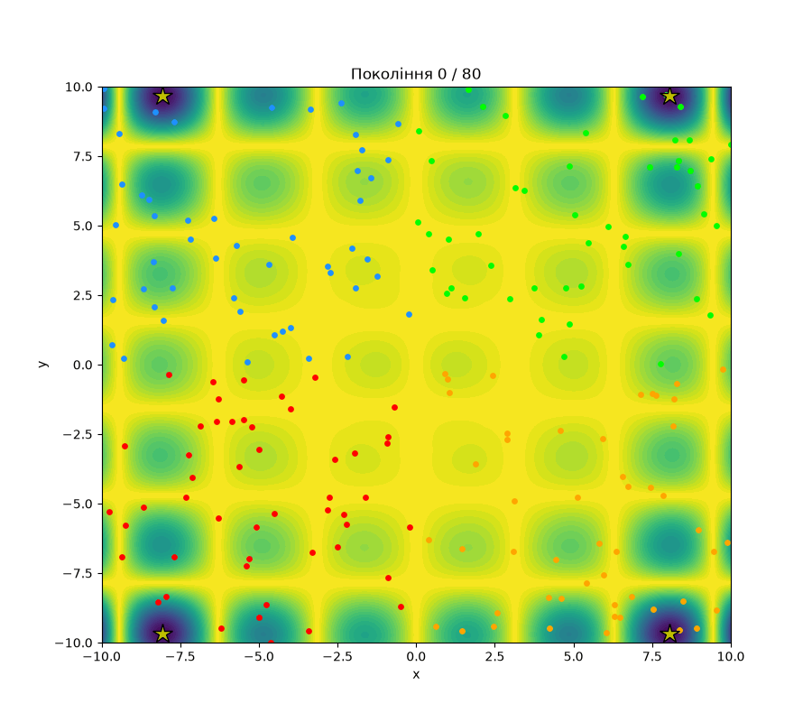
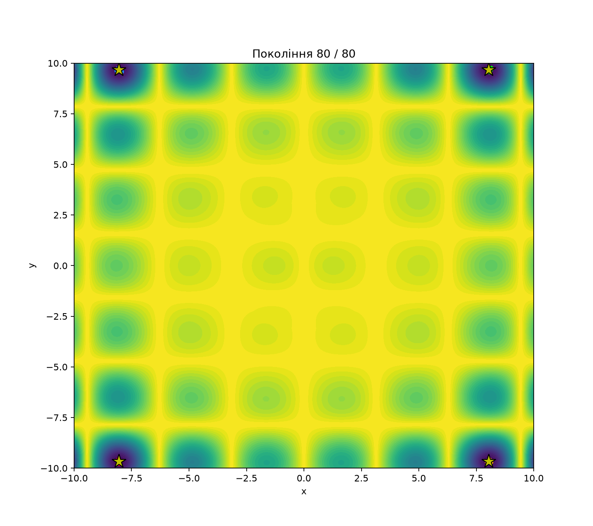
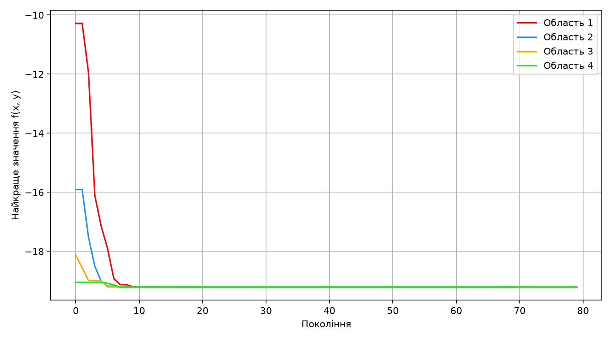

# Лабораторна робота

**Тема:** Пошук глобальних мінімумів функції Гьольдера генетичним алгоритмом

## 1. Мета роботи

Ознайомитися з принципом генетичного алгоритму, реалізувати його мовою Python для пошуку екстремумів тестової функції Гьольдера та візуально дослідити зміну популяцій у процесі оптимізації.

## 2. Теоретичні відомості

Генетичний алгоритм — це метод оптимізації, який використовує принципи природного відбору. Кожна особина є можливим розв'язком задачі. Для функції двох змінних особина задається координатами `(x, y)`.

Основні операції:

- **Ініціалізація** — випадкове створення початкових особин.
- **Оцінювання** — обчислення значення функції для кожної особини. Менше значення є кращим.
- **Відбір** — вибір кращих особин як батьків.
- **Схрещування** — отримання нової точки змішуванням координат батьків.
- **Мутація** — випадкова зміна координат для пошуку нових рішень.
- **Елітизм** — перенесення найкращих особин у наступне покоління без змін.

Обрана **функція Гьольдера** (Hölder table function):

$$
f(x,y)=-\left|\sin(x)\cos(y)\exp\left(\left|1-\frac{\sqrt{x^2+y^2}}{\pi}\right|\right)\right|.
$$

Область визначеного пошуку: `x, y ∈ [-10, 10]`.

Функція має чотири глобальні мінімуми в точках `(±8.05502, ±9.66459)` з відомим значенням `f(x,y) ≈ -19.2085`.

Звичайний генетичний алгоритм часто концентрується біля одного мінімуму. Щоб у цій роботі продемонструвати **всі чотири мінімуми**, область пошуку поділено на чотири частини за знаками `x` і `y`, і в кожній запускається **незалежна популяція**. Отже, програма розв'язує чотири окремі задачі мінімізації, а не виявляє всі чотири мінімуми одним спільним пошуком.

## 3. Засоби виконання

Мова програмування: **Python 3**.

Бібліотеки:
- `numpy` — масиви, випадкові числа та обчислення;
- `matplotlib` — побудова графіків і анімації;
- `pillow` — збереження GIF.

Середовище: **GitHub Codespaces** або локальний Python.

## 4. Хід виконання роботи

1. Створено функцію `holder(x, y)` для обчислення значення функції Гьольдера.
2. Область `[-10, 10] × [-10, 10]` поділено на чотири прямокутні частини: `[-10,0]×[-10,0]`, `[-10,0]×[0,10]`, `[0,10]×[-10,0]`, `[0,10]×[0,10]`.
3. У кожній частині випадково створено **50 особин**. Загалом в алгоритмі одночасно беруть участь **200 особин**.
4. Для кожної популяції обчислюються значення функції, після чого особини сортуються за зростанням цих значень.
5. **5 найкращих особин** зберігаються без змін. Для створення потомків випадково обираються двоє батьків серед **20 кращих**.
6. Координати двох батьків змішуються за випадковим коефіцієнтом: `child = mix * first + (1 - mix) * second`.
7. З імовірністю **50%** до координат потомка додається випадкове зміщення. Масштаб мутації поступово зменшується для уточнення розв'язку.
8. Координати кожної нової особини обмежуються відповідною частиною площини.
9. Із 5 збережених особин і 45 потомків формується нове покоління. Кроки повторюються **80 поколінь** у кожній частині.
10. Зберігаються всі покоління та найкращі значення функції для подальшої візуалізації.

## 5. Запуск програми

У репозиторії GitHub натиснути **Code → Codespaces → Create codespace on main**. У терміналі виконати:

```bash
python -m pip install -r requirements.txt
python main.py
```

Якщо Codespace відкрито у браузері, графічне вікно не потрібне: програма автоматично створить файли з результатами, які можна переглянути у файловому менеджері Codespaces.

## 6. Результати роботи

У терміналі програма виводить чотири знайдені точки та значення функції. За фіксованого `seed=7` один із перевірених запусків дав:

| Частина області | x | y | f(x,y) |
|---|---:|---:|---:|
| x < 0, y < 0 | -8.05499 | -9.66471 | -19.20850 |
| x < 0, y > 0 | -8.06193 | 9.66823 | -19.20789 |
| x > 0, y < 0 | 8.05281 | -9.66342 | -19.20844 |
| x > 0, y > 0 | 8.05502 | 9.66459 | -19.20850 |

Результати є наближеними: генетичний алгоритм не гарантує абсолютно точного знаходження глобального мінімуму.

**Анімація пошуку:** чотири популяції позначені різними кольорами; жовті зірки — відомі положення глобальних мінімумів.



**Рис. 1.** Зміна положення чотирьох популяцій у поколіннях.



**Рис. 2.** Розташування популяцій після 80 поколінь.



**Рис. 3.** Зміна найкращих значень функції для кожної із чотирьох областей.

## 7. Аналіз результатів

На початку особини розподілені випадково у своїх частинах області. У наступних поколіннях відбір і схрещування концентрують їх біля нижчих значень функції. Завдяки мутації нові особини також досліджують інші точки. На графіку збіжності видно покращення найкращого знайденого значення, а наприкінці кожна популяція наближається до свого глобального мінімуму.

## 8. Висновок

У лабораторній роботі реалізовано генетичний алгоритм мінімізації функції Гьольдера. Для демонстрації чотирьох глобальних мінімумів область пошуку розділено на чотири частини з незалежними популяціями. Отримано числові наближення до всіх чотирьох мінімумів і побудовано анімацію еволюції та графік збіжності. Експеримент показує, як генетичні операції допомагають поступово покращувати можливі розв'язки.

## 9. Використані джерела

1. [Test Functions for Optimization (Wikipedia, копія Scribd)](https://ru.scribd.com/document/412352508/Test-Functions-for-Optimization-Wikipedia)
2. [Genetic Algorithm: An Optimization Approach](https://medium.com/data-science/genetic-algorithm-an-optimization-approach-dd60e23261e6)
3. [Додатковий матеріал про генетичні алгоритми](https://aircconline.com/ijcses/V7N2/7216ijcses03.pdf)
